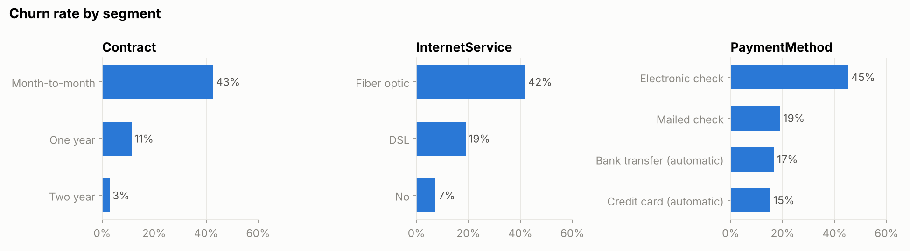
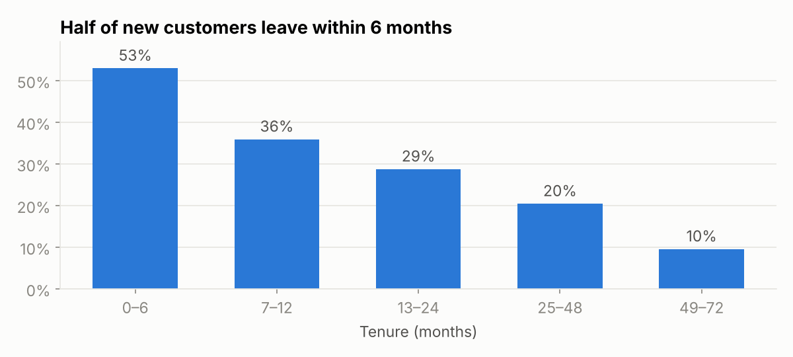
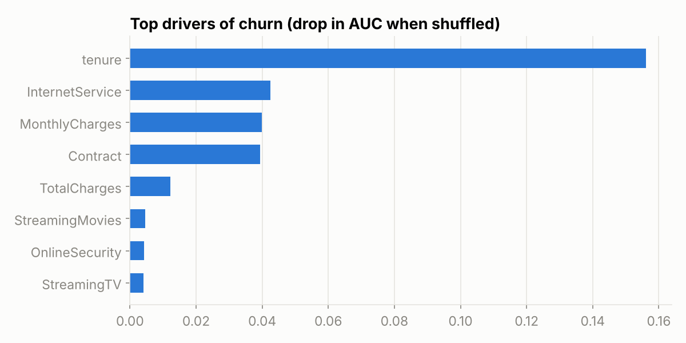
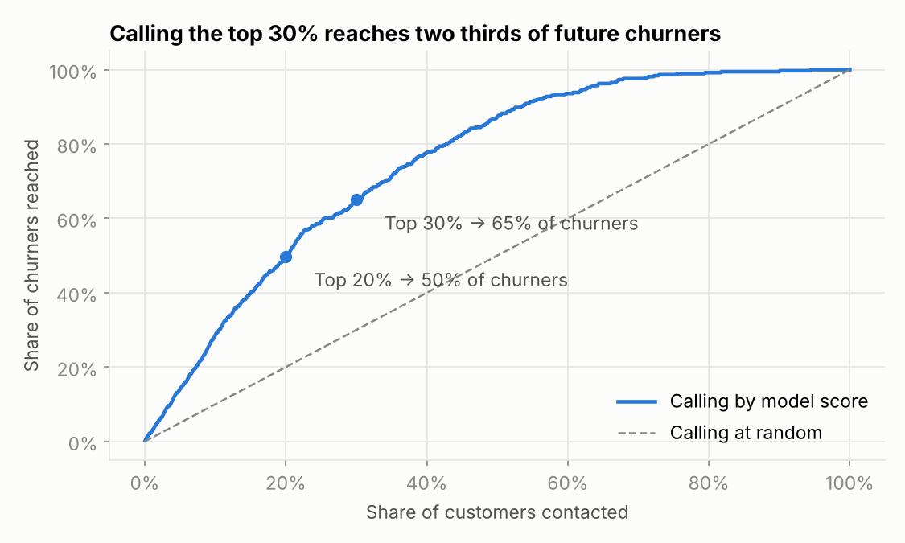

# Customer churn prediction

A telecom operator loses about one customer in four, and its retention team can only call a limited number of people each month. I wanted to answer a practical question: **who should they call first?**

The full analysis is in the notebook: [`churn_prediction.ipynb`](churn_prediction.ipynb).

## Data

IBM's public Telco Customer Churn sample: 7,043 customers, with their contract, services, billing and whether they left in the last month. The notebook downloads it automatically.

One cleaning detail worth mentioning: `TotalCharges` is stored as text and 11 values are empty. All of them belong to customers with a tenure of 0 months, so the right value is 0, not a missing value to impute.

## What the data says



Before any model, a few simple cuts already tell most of the story. Customers on month-to-month contracts leave at 43%, against 3% on two-year contracts. Those paying by electronic check leave three times more often than those on automatic payment. And the first months are critical: more than half of the customers who joined less than six months ago are gone.

The fiber optic result surprised me (42% churn against 19% for DSL). For a premium offer, that looks like a price or quality issue, and it is something I would raise with the product team.



## Model

I compared a logistic regression, a random forest and a gradient boosting model with 5-fold cross-validation, using ROC-AUC because the goal is to rank customers by risk.

| Model | ROC-AUC (CV) |
|-------|--------------|
| Logistic regression | 0.846 |
| Random forest | 0.845 |
| Gradient boosting | 0.844 |

The three are practically tied, so I kept the logistic regression: same performance, and much easier to explain to a business team. On the held-out test set it reaches an AUC of 0.842.



Tenure is by far the strongest driver, followed by internet service, monthly charges and contract type.

## What it means for the retention team



If the team calls customers in the order of the model's risk score:

| Customers contacted | Share of future churners reached |
|--------------------|----------------------------------|
| Top 10% | 28% |
| Top 20% | 50% |
| Top 30% | 65% |

With random calls, contacting 30% of the base would reach 30% of churners. With the score, it reaches about two thirds.

The actions I would test first: an incentive to move from monthly to annual contracts, a proper onboarding for new customers during their first six months, and pushing automatic payment.

## Limits and next steps

This is a sample dataset without a time dimension, so I can't check how the model behaves over several months. In a real setting I would retrain it regularly, monitor its performance, and measure the actual effect of the retention calls with an A/B test.

## Run it

```bash
pip install -r requirements.txt
jupyter notebook churn_prediction.ipynb
```
